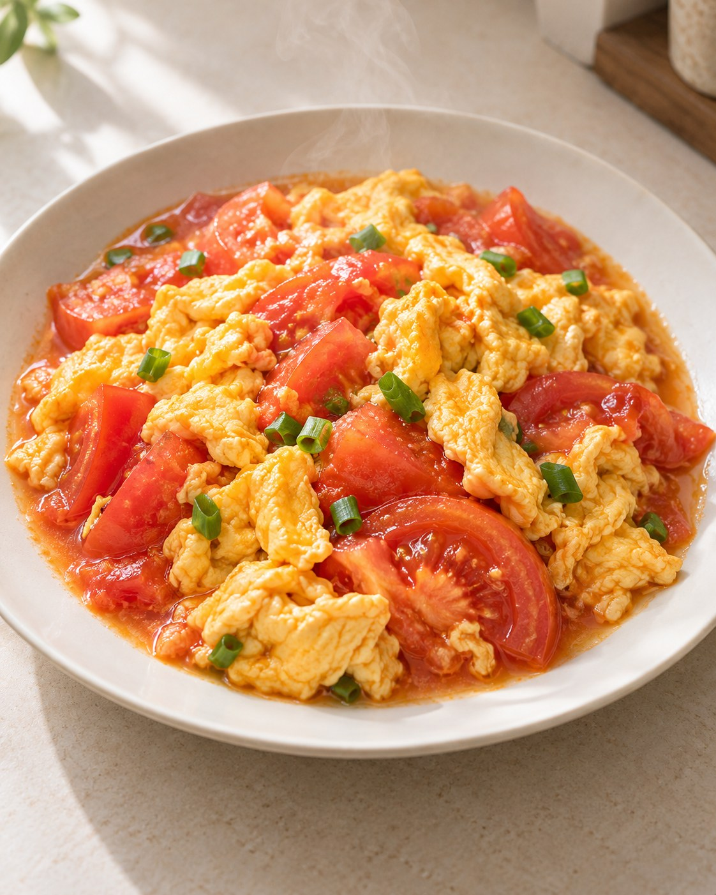
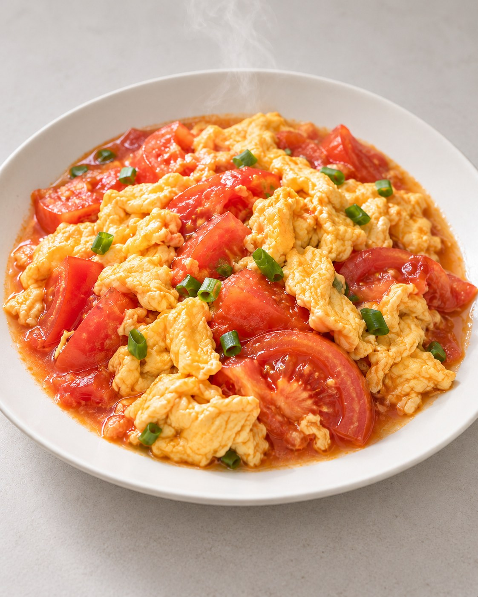
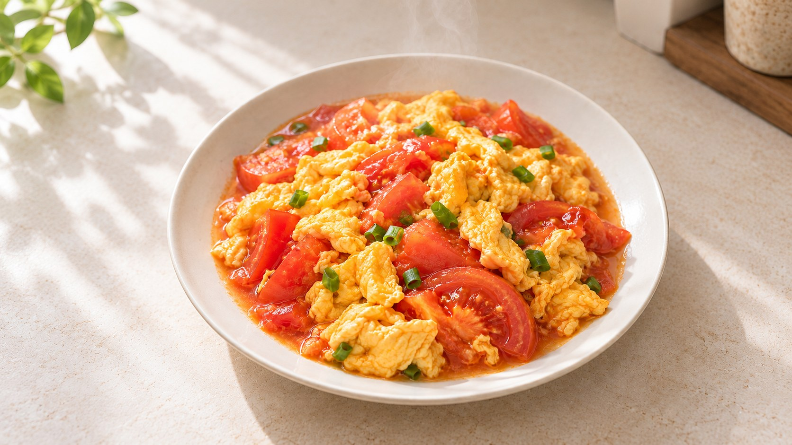
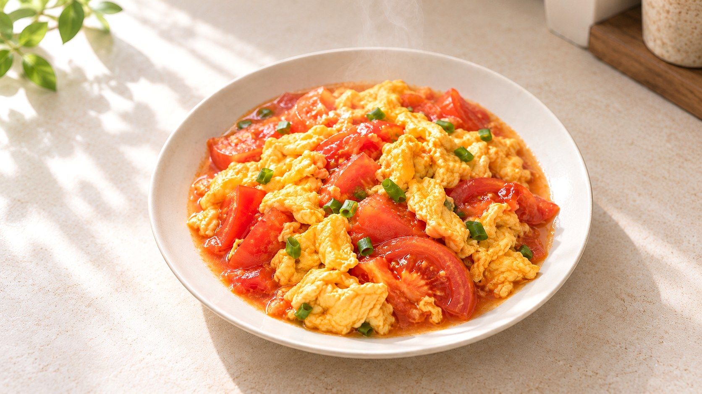

# 案例

本页只收录真实运行的案例。每个案例写明用户原话、运行版本、执行方式、实际结果、覆盖的能力和已知偏差。完整能力与验证范围见 [v13 能力清单](CAPABILITIES-v13.md)，用法见 [使用说明](USER-GUIDE.md)。

## 案例 A：番茄炒蛋，从一句话到改版、回退和导出

**类型**：真实运行案例。
**运行版本**：本仓库提交 `e2adb06` 中的 `development/runtime/before-chopsticks`，以项目级方式安装到一个空白测试项目。
**执行方式**：macOS 上的本地 Codex CLI 0.161.0，同一会话连续五轮自然语言对话，使用 Codex 原生图像工具。没有上传照片或参考图。
**图像用量**：实际调用 3 次，没有重试。第 3、5 轮不调用图像工具。

以下图片是展示用的 JPEG 压缩副本，原始输出为 PNG。

### 第 1 轮：直接要图

> 来一张番茄炒蛋，其他你决定。作品放在 works/fanqie。

直接设计并生成一张，没有先让用户选风格或方向。助手自主选定 4:5 竖幅、明亮的中间调，实际输出为 1122×1402，与目标比例一致。记为 V1。

提交的描述要求背景极简、整盘完整入镜。成图却多了左上角的绿植、右上角的木托盘和罐子，以及台面叶影，盘子左右边缘也被裁切。这些都不在描述里，是图像模型自行添加的。



### 第 2 轮：一句话提出两项修改

> 背景简单点，颜色别那么黄。

在 V1 上做生成式编辑，两项修改一起处理，得到 V2。右上角的器物、左上角的植物和窗影被去掉，台面与盘子转为中性浅灰，菜品和盘子的位置基本保持。V1 保留。



### 第 3 轮：只查看

> 看第一版。

展示 V1，不调用图像工具。之后的编辑对象仍是 V2。

### 第 4 轮：回到第一版另起一支

> 回第一版继续，改成横幅。

以 V1 为父版生成 V3，实际输出为 1672×941，约 16:9。V3 沿用 V1 的暖色窗光和浅色台面，没有带入 V2 的灰色背景。用户只要求改横幅，所以 V1 里的绿植和器物也一并保留。V2 仍保留，与 V3 是两条分支。



### 第 5 轮：本地微调并导出

> 这张亮一点点，然后导出 PNG。

在 V3 上做本地提亮，约 4%，得到 V4，再导出 PNG。这一步在本机完成，不调用图像工具。



### 版本关系

```text
V1 ─┬─ V2  背景简化、减黄（生成式编辑）
    └─ V3  横幅（生成式编辑）── V4  本地提亮 ── 导出 PNG
```

### 覆盖的能力

- 理解菜品，直接创作，自主决定画幅与影调。
- 一句话多项修改。
- 查看、回退继续与分支保留。
- 画幅更改，目标比例与实际尺寸分开核对。
- 本地调整亮度和导出 PNG。

### 已知偏差

- V1 出现了描述之外的绿植、器物和叶影，盘子边缘被裁。助手出图后的观察记录写到了这些，但要求核对仍记为通过，交付时也没有告诉用户。按 Skill 规则，这两处应记为未达到并向用户说明。
- 生成式编辑不是像素级保持。V3 里的番茄和鸡蛋块与 V1 并不逐块相同，只保留了整体菜品、盘子和环境。
- 用户只说了“横幅”，助手把具体比例 16:9 记成了用户明确要求。运行时的规则没有区分方向与具体比例，此后已补充：方向按用户要求记录，具体比例注明为设计选择。本案例图片按修正前的版本运行。
- 本案例只有一道菜、一次运行，不代表其他菜品、复杂动作或长时间多轮修改的稳定性。

### 未覆盖

本案例不包含以下内容，相关状态见能力清单：
- 先找方向和混选。
- 用户上传照片后的编辑。
- 多参考图。
- 系列创作。
- 点评和实拍指导。

## 图片许可

`examples/` 目录中的图片由 Codex 原生图像工具生成，不适用仓库代码的 MIT 许可，在权利人可授权的范围内以 [CC BY 4.0](https://creativecommons.org/licenses/by/4.0/deed.zh-hans) 提供。转载或改编时请署名“before-chopsticks-skill 案例图”，并附本仓库链接。
