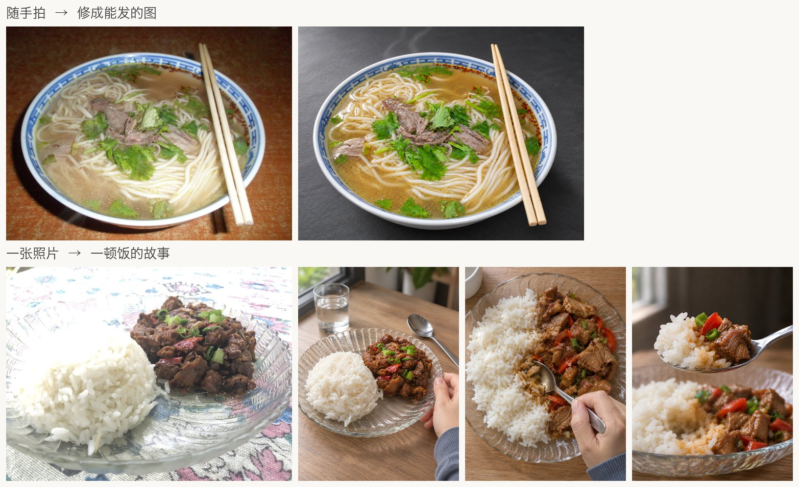

# 动筷之前 / before-chopsticks

**把一道菜拍成有生活感的照片，或者一组能直接开拍的分镜图＋拍摄脚本。** 一个面向本地 Codex 的美食摄影 Skill：发一张照片、说一道菜名，或者只说一个想法，它先给出看得懂的方案，你说“可以”再出图。套图按导演分镜来做：逐镜写景别、机位、运镜和视频提示词，每镜出首帧＋尾帧，供首尾帧视频工具生成短视频（视频效果需自己实测）。之后可以只改一张、再来一套，或换一道菜。



<sub>每行最左为输入照片，来自 Wikimedia Commons（Berthe，CC BY 3.0；Wheeler Cowperthwaite，CC BY 2.0），其余为 Skill 输出；来源与许可见[案例页](EXAMPLES.md#图片来源与许可)。</sub>

**看效果**：[真实运行案例](EXAMPLES.md)，覆盖分镜套图、修图、无图创作、只改一张、再来一套、借参考光色、只发图时的点评，以及和“一句话直接生图”的对比。

## 三步开始

1. 把仓库里的 `development/runtime/before-chopsticks` 整个目录复制到你项目的 `.agents/skills/before-chopsticks`（详见下文“项目级安装”）。
2. 在该项目里开一个新的 Codex 会话。
3. 说“可乐鸡翅，想拍成一条短视频，帮我出一组分镜”；或者发一张菜的照片，说“帮我拍得好看点”。

## 能做什么

- **先找方向**：给出具体画面和推荐理由，也可以混选不同方向的故事、光线或其他元素。
- **直接创作与续改**：明确要图时，按当前工具和授权执行；支持自然语言提出多项修改、选版与回退。
- **分镜套图**：先交完整拍摄脚本和摘要；反推目标菜品时先确认目标特征卡，摘要中已确认则不重复。批准具体生成范围与次数后，默认先出 1 张锚点（分镜规则允许 1–2 张），展示实际图并暂停等你（Owner）确认，再继续已授权剩余镜头，不重问整套授权。只有明确说“一次出完”“不要中途停”或“不需要锚点确认”才跳过中间停点，“直接出图”“可以开始”本身不算跳过；默认按 Seedance 首尾帧、3:4 竖幅编排。Skill 不生成视频，视频效果需你自己实测。
- **其他多图**：独立候选、统一视觉系列，或几道菜各一张而不统一场景。
- **辅助拍摄**：根据实际照片点评，或根据现场条件给出实拍指导。只讨论方案、点评或实拍指导时不会自动生图。

## 安装前

需要本地 Codex、Python 3、Pillow 和支持 `fcntl` 的系统；生图或生成式编辑还需要当前宿主可用的原生图像工具。macOS 有限定验证；Linux 未验证，原生 Windows 不承诺兼容。使用 Codex 所在环境的 Python 检查依赖：

```bash
python3 -c 'import PIL, fcntl; print("Python 依赖可用")'
```

如果缺少 Pillow，请按你的 Python 环境安装后再检查；开发用校验器另需 PyYAML，不是运行依赖。图片生成可能消耗账户用量，具体以当前服务为准。

## 项目级安装

将仓库中的 `development/runtime/before-chopsticks` **完整目录**复制到目标项目的 `.agents/skills/before-chopsticks`，包括其中的 `LICENSE`。如果目标已存在，先将原目录备份到其他位置，确认后再替换；不要将两个版本直接合并。

安装后在目标项目打开一个新的 Codex 会话，确认会话能发现该 Skill。如未发现，检查当前工作目录是否为安装项目，再开启新会话。发现 Skill 与成功出图是不同的验证。

两种开始方式都可以，探索不是必经步骤：

- **直接创作**：“来一碗牛肉面，竖幅，其他你决定。”会先用一两句说明画面设计并问“可以吗”，回“可以”后生成一张，可能消耗图像用量。
- **先找方向**：“牛肉面先给几个不同方向，不生图。”得到几个可比较的画面方向和推荐，不调用图像工具。

## 接着怎么用

- “怀旧，但要亮调。”
- “第二个故事、第一种光，不要手。”
- “三道菜各一张，不统一场景。”
- “看第一版。”——只查看，不改变后续编辑对象。
- “回第一版继续。”——从第一版建立后续修改。

三条入口的完整话术、预期结果、升级备份、恢复与卸载见 [Markdown 使用指南](USER-GUIDE.md)；仓库也提供 [HTML 使用指南](USER-GUIDE.html)，其中指向其他文档的链接需与仓库文件放在一起使用。卸载 Skill 不会自动删除作品目录；从独立备份恢复尚未实际演练。

能做什么、已验证到哪一步和已知限制见 [能力清单](CAPABILITIES.md)。真实运行的对话和图片见 [案例](EXAMPLES.md)。

## 限制与隐私

作品须由用户逐图复核。分镜套图里，单只食材特写可能偏大，跨镜的工具外观和食材处理形态可能漂移；自查不合格的帧会标为缺帧、不当合格帧交付。整图改光的一致性、倒液时保持容器比例与位置、多参考属性解耦、复杂动作及跨题材稳定性均有限；完整自动新会话出图链尚未验证。生成式编辑不保证像素级不变。

本地作品目录可能保存素材、版本和调用记录；使用原生图像工具时，提示词及图像输入可能发送到服务端。分享诊断信息前请移除密钥、账户信息及不愿公开的内容。失败或提交状态未知时不会自动重发。

## 开发与许可

离线测试从仓库根目录运行：

```bash
PYTHONDONTWRITEBYTECODE=1 python3 -m unittest discover -s development/evidence/tests -q
```

本仓库由维护者的开发源按精确白名单导出。欢迎直接对本仓库提交 issue 或 PR，被采纳的修改由维护者同步回开发源后再导出，避免两份副本漂移。本仓库随附 [MIT 许可](LICENSE)，适用于权利人有权授权的项目内容；第三方内容适用各自许可，MIT 通知不替代第三方授权。案例页图片另行授权：生成图以 CC BY 4.0 提供，输入照片保留各自原许可，见 [案例](EXAMPLES.md) 文末。历史研究资料不包含在候选中。
